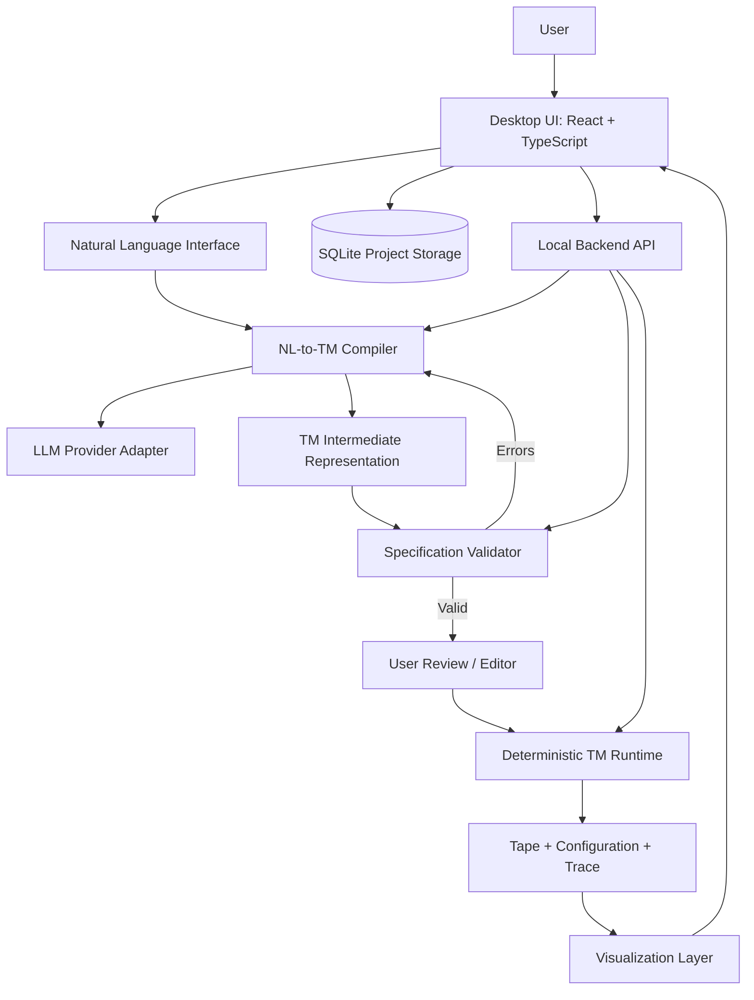

# System Architecture

## High-level architecture

## Recommended stack

| Layer | Recommendation | Notes |
|---|---|---|
| Desktop shell | Tauri 2 | Native packaging; lightweight |
| Frontend | React + TypeScript | Component-based interface |
| UI state | Zustand | Shared simulation and editor state |
| Tape rendering | SVG | Accessible, scalable, interactive |
| Animation | Framer Motion | Head and cell animation |
| Backend | Python + FastAPI | Compiler, validation, runtime |
| Schema validation | Pydantic | Runtime validation of IR |
| LLM | Provider adapter for Ollama or hosted APIs | Keep vendor-independent |
| Persistence | SQLite | Projects, machines, sessions, traces |
| Packaging | Tauri bundler | Windows, macOS, Linux |

Alternative: Electron + React if a JavaScript-only desktop stack is preferred. Tauri is the default recommendation.

## Architectural boundaries

### 1. Frontend
Responsible for:
- Prompt editor and clarification dialogue.
- Specification editor and transition table.
- Tape, state, transition, and trace visualization.
- Playback controls and user interaction.
- Project browsing and export UI.

Must not implement the authoritative TM transition semantics.

### 2. Compiler
Responsible for:
- Building prompts for the selected LLM.
- Interpreting natural-language descriptions.
- Detecting ambiguity and missing semantic details.
- Producing schema-conforming IR.
- Returning clarification requests rather than inventing behavior.

Must not execute generated code.

### 3. Validator
Responsible for:
- Schema validation.
- State and alphabet reference checks.
- Transition determinism checks.
- Duplicate and conflicting transition checks.
- Blank-symbol and start-state checks.
- Warnings about unreachable states and incomplete transition coverage.

### 4. Runtime
Responsible for:
- Tape representation.
- Configuration model.
- Transition lookup and application.
- Halting semantics.
- Step limits.
- Execution trace.
- Undo/replay support.

Must be deterministic and independent of the LLM.

### 5. Visualization
Responsible for:
- Rendering the tape and blank cells.
- Rendering head location and active cell.
- Animating transitions.
- Displaying state and transition details.
- Rendering trace and breakpoints.

## Data flow
1. Prompt enters the compiler.
2. Compiler returns either a clarification request or a TM specification.
3. Validator returns errors/warnings and a validity status.
4. User reviews and edits the specification.
5. Runtime receives validated specification plus input string.
6. Runtime emits configurations and execution events.
7. Visualization consumes events/configurations and renders them.
8. Storage persists project, machine, and optionally trace.

## Standalone and offline strategy
- The desktop application hosts the UI and local backend.
- Local API communication may use localhost during development.
- The runtime, validator, editor, and saved projects must function offline.
- Natural-language compilation can use Ollama locally or an optional hosted API.
- Clearly show when compilation requires network access.
- Never make cloud connectivity a requirement for executing an already-defined TM.
